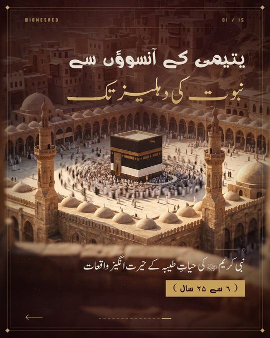
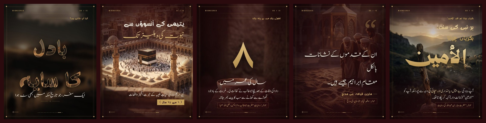
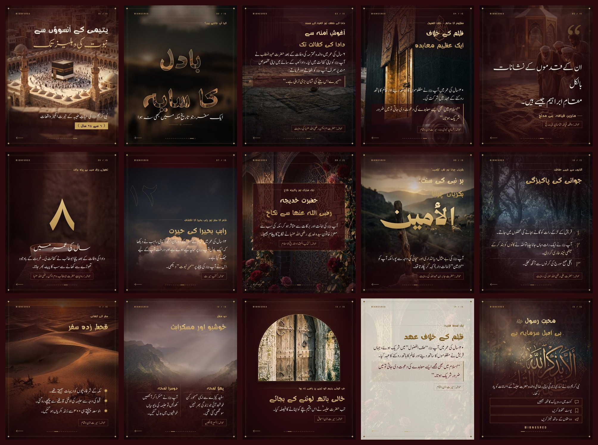
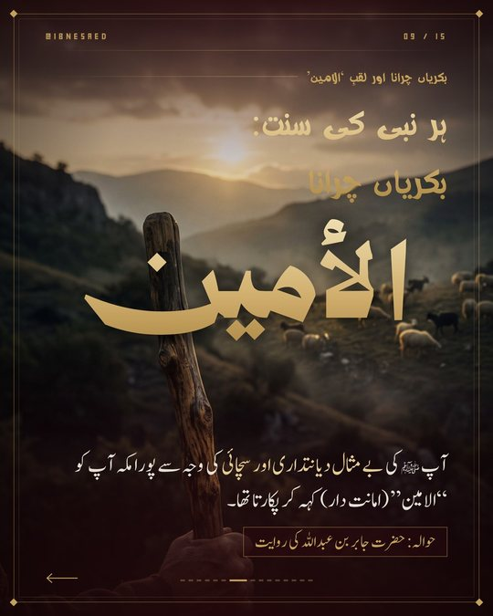
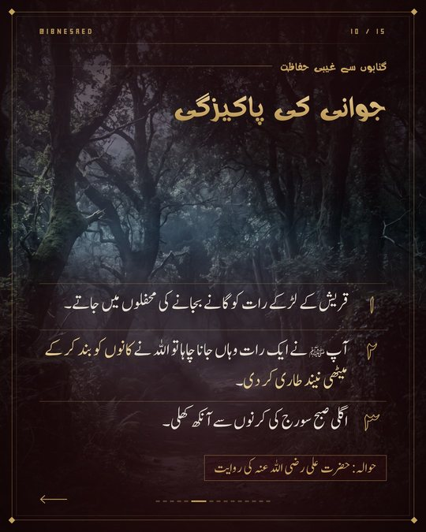
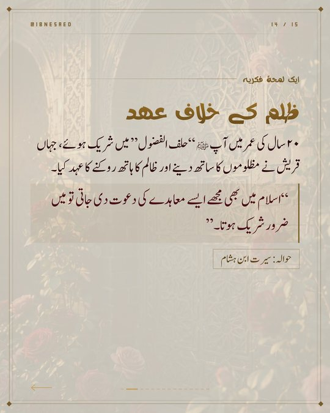

<div align="center">

# Islamic Post Creator &nbsp;v2

**A Claude Skill that turns an ayah, hadith, seerah story or any Islamic topic into a complete, on-brand Instagram carousel, in one run.**

*Slide text and photos in &nbsp;→&nbsp; designed Urdu / Arabic slides, PDF and contact sheet out.*

[](https://claude.ai)
[](https://playwright.dev)
[](#-the-15-layouts)
[](#-bundled-fonts)
[](https://instagram.com/ibnesaed)
[](https://instagram.com/abdullahahmad.me)

</div>

<p align="center">
  
</p>

<p align="center"><sub>A complete, branded carousel — from a single prompt to ready-to-post slides.</sub></p>
<p align="center">
  
</p>

---

## Contents

1. [What is new in v2](#-what-is-new-in-v2)
2. [What this skill does](#-what-this-skill-does)
   - [Example output](#-example-output)
3. [Quick start](#-quick-start)
4. [The pipeline](#-the-pipeline)
5. [The 15 layouts](#-the-15-layouts)
6. [Spec file reference](#-spec-file-reference)
7. [Bundled fonts](#-bundled-fonts)
8. [Brand system and how to make it yours](#-brand-system-and-how-to-make-it-yours)
9. [Rules the skill follows](#-rules-the-skill-follows)
10. [Retention playbook](#-retention-playbook-what-makes-people-stop-and-swipe)
11. [Command line reference](#-command-line-reference)
12. [Project structure](#-project-structure)
13. [Installation](#-installation)
14. [Example prompts](#-example-prompts)
15. [Saving credits](#-saving-credits)
16. [Troubleshooting](#-troubleshooting)
17. [Fonts and licensing](#-fonts-and-licensing-read-before-publishing)
18. [Accuracy note](#-a-note-on-accuracy)
19. [Credits](#-credits)

---

## What is new in v2

| Area | v1 | v2 |
|---|---|---|
| Building slides | One hand-written HTML file per slide, rendered one by one | **One command builds the whole carousel** from a JSON spec |
| Design | A new style invented every post | **15 ready layouts**, one brand system, automatic frame, handle, counter, progress dots and swipe arrow |
| Fonts | Google/Noto fallbacks | **16 bundled Urdu and Arabic fonts**, with a capability table so the right one is used for the right text |
| Output | Heavy 2x PNGs | **Light 1080x1350 JPGs (about 250 KB each), a PDF and a contact sheet** that opens on any device |
| QA | View every slide separately | **Single `sheet.jpg`** shows the whole carousel at once |
| Editing | Redo the slide | **`--only 4,7`** rebuilds only the slides you changed; the spec is saved with the output |
| Brand | Chosen each time | **Ibnesaed palette baked in**, with a documented way to swap in your own |
| Digits | Manual | Western digits become **Urdu numerals** automatically |
| Safety checks | None | Build validates layout names, missing images, missing fonts and over-long slides |
| Credits | Many render and fix loops | Designed to finish in **one run** with a single QA look |

---

## What this skill does

```
 Slide text + photos                                                   Ready to post
 (or an ayah / hadith / topic)                                         ┌────────────┐
        │                                                              │ slide_01.jpg│
        ▼                                                              │ slide_02.jpg│
 ┌────────────┐   ┌──────────────┐   ┌────────────┐   ┌────────────┐   │    ...      │
 │  Capture   │ → │   Verify     │ → │   Pick     │ → │  ONE build │ → │ carousel.pdf│
 │  intent    │   │   source     │   │  layouts   │   │  command   │   │  sheet.jpg  │
 └────────────┘   └──────────────┘   └────────────┘   └────────────┘   │  spec.json  │
                  (skipped if you                                      └────────────┘
                   say it is verified)                                   + caption
```

It is built for Urdu and Arabic Islamic content, where most AI graphics fail: broken Nastaliq, wrong font for the language, clipped diacritics, inconsistent branding between posts and unverified quotations. This skill fixes each of those by design.

---

## Example output

All slides below were produced by `templates/example_spec.json` with one command (photos are AI-generated reference images supplied by the account; replace the `bg` paths in the spec with your own to run it).

<p align="center"></p>

### Selected layouts, in detail
<table>
  <tr>
    <td align="center"><br><sub><b>cover_stack</b><br>Classic cover</sub></td>
    <td align="center"><br><sub><b>hero_swash</b><br>Arabic swash hero</sub></td>
    <td align="center"><br><sub><b>numbered_list</b><br>Numbered points</sub></td>
  </tr>
  <tr>
    <td align="center"><br><sub><b>ivory_text</b><br>Light paper slide</sub></td>
    <td colspan="2" align="center"><sub><b>15 layouts total</b><br>See the contact sheet above for the complete visual system.</sub></td>
  </tr>
</table>

### From spec to slide
```json
{ "layout": "big_number", "bg": "bowl.jpg", "kicker": "تھوڑے رزق میں بے پناہ برکت",
  "number": "8", "caption": "سال کی عمر میں",
  "body": "دادا کی وفات کے بعد چچا ابوطالب نے کفالت لی۔",
  "ref": "حوالہ: روایاتِ حضرت ابوطالب و ام ایمن رضی اللہ عنہا" }
```

The `8` becomes an Urdu numeral automatically, the frame, handle, counter, progress dots and swipe arrow are added, and the photo is shaded with the brand maroon so the text stays readable.

---

## Quick start

**1. Install** (see [Installation](#-installation)), then in a new chat:

> *"Use islamic-post-creator. Text is already verified. Make a 10-slide Urdu carousel from this text and these images (in slide order). Use different layouts, no emojis."*

Attach the slide text and the images. That is all. The skill writes a spec, runs one build and returns the files.

**2. Or run it yourself:**

```bash
python3 scripts/build_carousel.py templates/example_spec.json out/
```

You get `out/slide_01.jpg ... slide_14.jpg`, `out/carousel.pdf`, `out/sheet.jpg` and `out/spec.json`.

---

## The pipeline

### 1. Capture intent
The skill infers content type (ayah, hadith, seerah, topic), language, slide count (usually 3 to 10) and account (default `@ibnesaed`). If you supply text and images it **does not ask questions**, it builds. Images given "in sequence" are matched to slides in order; the skill checks timestamps against each slide's visual cue because some tools list files in reverse.

### 2. Source verification
| Source | Checked against |
|---|---|
| Quran ayah | [Quran.com](https://quran.com) / [corpus.quran.com](https://corpus.quran.com): surah, ayah number, Arabic text, translation |
| Hadith | [Sunnah.com](https://sunnah.com): wording, narrator, authenticity grade (sahih / hasan / da'if) |

Weak or unfound hadith are reported, never presented as authentic. **If you state the text is already verified, this step is skipped** and your text is used as given; only digits, quotes and emojis are normalised, and obvious typos are flagged in one line instead of silently changed.

### 3. Design
Brand palette and bundled fonts are applied automatically. The skill chooses a **different layout for each slide** following the [retention playbook](#-retention-playbook-what-makes-people-stop-and-swipe).

### 4. Build
One command renders everything. Frame, handle, slide counter, progress dots and swipe arrow are added to every slide automatically.

### 5. Caption
Hook in the first two lines, reflection, full citation, call to action (save / share / comment durood) and 5 to 15 hashtags mixing broad (`#islam #seerah #quran`) and niche tags, matched to the account's earlier style.

### 6. Deliver
JPGs and PDF are placed flat in the outputs folder (no sub-folders, no heavy files). If a file will not open on the user's device the PDF is sent instead.

---

## The 15 layouts

Every layout gets the same frame, header and navigation, so a mixed carousel still feels like one family.

| # | Layout | Fields | Best for |
|---|---|---|---|
| 1 | `cover_stack` | `line1` `line2` `sub` `chip` | Classic cover: two-tier title (cream plus gold gradient) and an age or part chip |
| 2 | `image_text_hook` | `word` `sub` `kicker` `word_size` | **Scroll-stopping hook.** A giant word filled with the photo |
| 3 | `top_text` | `kicker` `title` `body` `quote` `ref` `wm` | Story slide with the photo still visible below |
| 4 | `bottom_card` | `kicker` `title` `body` `quote` `ref` | Title on top, quote card at the bottom; photos with a central subject |
| 5 | `quote_poster` | `quote` `by` `ref` | Minimal poster: one huge line over a dimmed photo; highly shareable |
| 6 | `big_number` | `number` `caption` `kicker` `body` `ref` | Giant gold numeral for an age, count or year |
| 7 | `editorial_split` | `kicker` `title` `body` (list) `ref` `wm` | Longer text: photo on top fading into a solid text base |
| 8 | `hero_swash` | `swash` `kicker` `title` `body` `ref` | Giant Arabic swash word (Zain Swashes) over a photo |
| 9 | `center_card` | `kicker` `title` `body` `ref` | Framed centred card over busy photos (patterns, roses) |
| 10 | `numbered_list` | `kicker` `title` `items[]` `ref` | Two to four points or steps |
| 11 | `timeline` | `kicker` `title` `items[]` `ref` | A journey or sequence of events |
| 12 | `diptych` | `kicker` `title` `cols[{label,text}]` `ref` | Two moments, two witnesses, before and after |
| 13 | `arch_window` | `kicker` `title` `body` `ref` | Photo inside a mihrab-style arch; calm and elegant |
| 14 | `ivory_text` | `kicker` `title` `body` `quote` `ref` | **Light paper slide** to break the dark rhythm; reflection and dua text |
| 15 | `cta_outro` | `title` `body` `ctas[{icon,text}]` `handle` | Final slide: comment, save and share rows (`comment` `save` `share` `like`) |

A visual gallery of all layouts is produced by building `templates/example_spec.json`.

---

## Spec file reference

A carousel is a JSON file. Everything else is automatic.

```json
{
  "handle": "@IBNESAED",
  "urdu_digits": true,
  "slides": [
    {
      "layout": "cover_stack",
      "bg": "/path/to/photo.jpg",
      "line1": "یتیمی کے آنسوؤں سے",
      "line2": "نبوت کی دہلیز تک",
      "sub": "نبی کریم ﷺ کی حیاتِ طیبہ کے حیرت انگیز واقعات",
      "chip": "( 6 سے 25 سال )"
    },
    {
      "layout": "top_text",
      "bg": "/path/to/photo2.jpg",
      "pos": "50% 100%",
      "kicker": "دادا کی شفقت",
      "title": "آغوشِ آمنہ سے\nدادا کی کفالت تک",
      "body": "6 سال کی عمر میں [[حضرت عبدالمطلب]] نے آپ ﷺ کو اپنی کفالت میں لیا۔",
      "quote": "“میرے اس بیٹے کی شان بڑی نرالی ہے۔”",
      "ref": "حوالہ: حضرت ام ایمن رضی اللہ عنہا کی روایت"
    }
  ]
}
```

### Common fields
| Field | Meaning |
|---|---|
| `layout` | One of the 15 layout names |
| `bg` | Absolute path to the background photo |
| `pos` | Photo position, for example `"50% 100%"`, so the subject stays visible and text never covers it |
| `kicker` | Small gold label above the title (usually the slide's topic) |
| `title` | Main title (`\n` for a line break) |
| `body` | Text, or a list of paragraphs |
| `quote` | Highlighted quotation block |
| `ref` | Source chip, for example `حوالہ: صحیح مسلم` |
| `wm` | Giant outlined numeral watermark behind the text (age, part number) |
| `no_arrow` | Hide the swipe arrow on this slide |

### Text markup
| Markup | Result |
|---|---|
| `[[text]]` | Gold highlight (use on the one emotional line of a slide) |
| `{{UM:محمد}}` | Inline different font (any code from the font table) for pure Arabic words |
| `\n` | Line break |
| `6`, `25` | Converted to Urdu numerals automatically (disable with `"urdu_digits": false`) |

### Built-in checks
Before rendering, the build stops on an unknown layout name or a missing photo, and warns about missing font files and slides with more than about 700 characters.

---

## Bundled fonts

All fonts live in `fonts/` and are registered automatically. **Never download fonts when these exist.**

| Code | Font | Urdu | Arabic | English | Use for |
|---|---|:-:|:-:|:-:|---|
| `JN` | Jameel Noori Nastaleeq Regular | yes | yes | yes | **Urdu body text** (renders small, sizes are already tuned) |
| `JK` | Jameel Noori Nastaleeq Kasheeda | yes | yes | yes | Stretched Urdu display titles |
| `KF` | Kinafah | yes | yes | no | Large Urdu / Arabic headlines |
| `CC` | Cocon Next Arabic Light | yes | yes | yes | Thin elegant lines (avoid words starting with ہ: it looks like م) |
| `DT` | DecoType Thuluth | yes | yes | no | Thuluth calligraphy headlines (no ﷺ glyph) |
| `MD` | Madani Arabic DEMO | yes | yes | yes | Modern display font (demo build: test glyphs) |
| `EG` | Elgharib KFGQPC Hafs Taweel | partial | yes | no | **Quranic Arabic only.** Urdu letters break into dots |
| `ZS` | Zain Swashes (variable) | no | yes | no | Giant swash Arabic words (الأمين, حلف الفضول) |
| `Z4` | Zain Mobile 400 (also 200 and 600 files included) | no | yes | no | Arabic-only words |
| `UM` | Ummi | no | yes | no | Arabic-only names (محمد, احمد) |
| `QB` | Qalbi | no | yes | no | Arabic-only display names |
| `KM` | Kan Ya Ma Kan | no | yes | yes | Latin handle and counters, Arabic-only words |
| `MH` | Mohawla | no | yes | no | Arabic-only display words |
| `CT` | ae Cortoba | no | yes | yes | Arabic-only words, Latin text |

**Golden rule:** fonts marked "Urdu: no" cannot draw the letters ٹ ی ہ گ. Use them only for words made purely of Arabic letters, inline with `{{CODE:text}}`. The full capability table is in [`fonts/FONTS.md`](./fonts/FONTS.md).

**Special glyph note:** in Jameel, ﷺ draws the full "salla Allahu alayhi wa sallam" calligraphy. The builder sets it automatically to half size so it sits inside the line.

---

## Brand system and how to make it yours

The default brand is **IbneSaed**:

| Token | Name | Hex | Used for |
|---|---|---|---|
| `--obs` | Deep Velvet Maroon | `#2C0B0E` | Slide background, photo shading, ink on light slides |
| `--mar` | Imperial Burgundy | `#4A0E17` | Secondary accent, quote bars |
| `--gold` | Brushed Antique Gold | `#C5A059` | Frame, labels, chips, gradient titles |
| `--gold2` | Gold highlight (derived) | `#E3CB92` | `[[highlighted]]` words |
| `--cream` | Warm Alabaster | `#E5DFD3` | Body text, light-slide paper |

Photos are shaded with the maroon tint (`44,11,14`), never pure black, so every slide shares the same temperature.

### Make it your own brand in 5 steps

1. **Handle:** set `"handle": "@YOURBRAND"` in the spec (appears on every slide).
2. **Palette:** the colours are defined once in `:root` at the top of `scripts/build_carousel.py`, and as RGB triplets inside the shading and frame rules. Replace them everywhere in both `scripts/build_carousel.py` and `scripts/layouts.py`:

   | Find | Replace with |
   |---|---|
   | `#2C0B0E` and `44,11,14` | your background colour (hex and `R,G,B`) |
   | `#4A0E17` | your secondary colour |
   | `#C5A059` and `197,160,89` | your main accent (hex and `R,G,B`) |
   | `#E3CB92` | a lighter tint of your accent |
   | `#E5DFD3` | your text colour |
   | `#F1E1B4`, `#D2B070`, `#A98440` | the three stops of your title gradient (light to dark accent) |
   | `#7A5C28`, `#5E4318`, `#9A7632`, `122,92,40` | dark accent shades used on the light `ivory_text` slide |
   | `#EFE9DD` | paper colour of the light slide |

   Example (Linux/macOS):
   ```bash
   sed -i 's/#C5A059/#1F6F54/g; s/197,160,89/31,111,84/g' scripts/build_carousel.py scripts/layouts.py
   ```
3. **Fonts:** drop your font files into `fonts/` and add a code to the `FILES` dictionary in `scripts/build_carousel.py`:
   ```python
   'AB': 'MyArabicFont-Regular.ttf',
   ```
   Then use it in a layout's CSS (`font-family:'AB','JN',serif`) or inline in text with `{{AB:كلمة}}`. Always keep `'JN'` as a fallback for missing glyphs.
4. **Frame and ornaments:** the gold double frame, corner diamonds and dots are in `FR` and `BASE` in `scripts/build_carousel.py`. Change `inset`, border style or remove them.
5. **Tell the skill:** edit the "IbneSaed brand palette" section of `SKILL.md` (and `templates/PALETTE.md`) so the skill uses your palette and name by default in every chat.

### Add your own layout

A layout is one Python function returning `(css, html)`. Add it to `scripts/layouts.py` and register it in the `LAYOUTS` dictionary:

```python
def my_layout(d):
    css = ".mine{font-family:'KF','JN',serif;font-size:90px;color:var(--gold)}"
    h = bgd(d) + shade((.9,.4,30),(0,50),(.8,70,.95))        # photo + maroon shading
    h += blk(f'<div class="mine">{H(d["title"])}</div>', 'top:200px')
    return css, h

LAYOUTS['my_layout'] = my_layout
```

Helpers: `bgd` (photo), `shade` (gradient overlay), `blk` (positioned text block), `H` (markup to HTML), `kick` `title` `paras` `quote` `ref` (standard parts). Then document the fields in `templates/LAYOUTS.md`.

---

## Rules the skill follows

**Content**
- Verify every ayah and hadith unless the user states the text is already verified.
- Use the user's text as given; flag typos in one line, never silently change meaning.
- No emojis anywhere on slides (built-in SVG icons and ornaments are used instead).
- No invented text, no human faces.
- One idea per slide, about 45 words maximum.

**Design**
- Brand colours only; never pure black; photos shaded with the maroon tint.
- A different layout on each slide; one light `ivory_text` slide mid-way to break the rhythm.
- Slide 1 is a hook (`image_text_hook` or `cover_stack`); the last slide is `cta_outro`.
- Text never covers the photo's main subject (use `pos`).
- Series continuity: same palette, fonts and layout family as earlier parts.

**Typography**
- Bundled fonts only, Urdu text only in fonts marked Urdu.
- Arabic-only fonts only for pure-Arabic words.
- `@font-face` CSS must be the **first** rule in the page style; otherwise fonts silently fall back.
- Nastaliq needs generous line height; avoid `overflow:hidden` near text.
- Use curly quotes “ ” ‘ ’; Elgharib is never used for Urdu.
- Urdu numerals by default; keep one convention in a post.

**Output**
- 1080x1350 (4:5) by default; square on request.
- Light JPG plus PDF, delivered flat. If a file does not open, send the PDF.
- Render once, view `sheet.jpg` once, fix only what is broken.

---

## Retention playbook: what makes people stop and swipe

1. **Hook first.** Slide 1 needs a curiosity line or a one-word image-text hook, not just a title.
2. **Alternate dense and airy.** Put `big_number`, `quote_poster` or `hero_swash` between text slides.
3. **Break the colour rhythm.** One `ivory_text` slide in the middle.
4. **One emotional line per slide** in gold `[[...]]`.
5. **Show progress.** The dots and swipe arrow are automatic, so viewers know how much is left.
6. **End with an action.** `cta_outro`: comment durood, save, share to three friends.
7. **Respect the photo.** Choose `pos` so the subject stays visible.

---

## Command line reference

### `scripts/build_carousel.py`: the main builder
```bash
python3 scripts/build_carousel.py SPEC.json OUT_DIR [--only 4,7] [--png]
```
| Option | Meaning |
|---|---|
| `SPEC.json` | Carousel spec |
| `OUT_DIR` | Output folder (created if missing). Receives `slide_NN.jpg`, `carousel.pdf`, `sheet.jpg`, `spec.json` |
| `--only 4,7` | Rebuild only these slides after editing the spec; other JPGs are kept, PDF and sheet are refreshed |
| `--png` | Also keep the 2x PNGs (off by default to save space) |

### `scripts/prep_images.py`: shrink big photos first
```bash
python3 scripts/prep_images.py photo1.jpg photo2.jpg OUT_DIR
python3 scripts/prep_images.py INPUT_FOLDER OUT_DIR
```
Resizes to a maximum width of 1400 px (slides are 1080 wide) at quality 90. Faster builds and lighter chats with no visible loss.

### `scripts/render_slide.py`: single custom slide (only if no layout fits)
```bash
python3 scripts/render_slide.py input.html output.png [--width 1080] [--height 1350] [--scale 2.0] [--full-page]
```
Waits for `document.fonts.ready` before capture so fonts never fall back.

---

## Project structure

```
islamic-post-creator/
├── SKILL.md                      # The skill: pipeline, rules, brand, fast-build instructions
├── README.md                     # This file
├── fonts/
│   ├── FONTS.md                  # Capability table: which font can draw what
│   └── *.ttf / *.otf             # 16 bundled Urdu and Arabic font files
├── scripts/
│   ├── build_carousel.py         # One-command builder (spec to JPG + PDF + sheet)
│   ├── layouts.py                # The 15 layouts
│   ├── prep_images.py            # Image shrinker
│   └── render_slide.py           # Single-slide HTML to PNG renderer
├── docs/
│   └── examples/                 # Preview images used in this README
├── templates/
│   ├── LAYOUTS.md                # Layout fields and the retention playbook
│   ├── PALETTE.md                # Brand palette tokens
│   └── example_spec.json         # Working example using all layouts
└── references/
    ├── typography.md             # Font roles, RTL and Urdu rules, pitfalls
    └── design-system-tokens.md   # Token schema and baseline directions
```

---

## Installation

1. Zip the **`islamic-post-creator`** folder (the folder itself must be the top level of the zip, with `SKILL.md` directly inside it).
2. In Claude open **Settings, Skills**, upload the zip and save. If an older version exists, replace it.
3. Start a **new chat**. Skills do not update inside chats that were already open.
4. Check: ask *"list the fonts folder and scripts of islamic-post-creator"*. You should see the 16 fonts, `build_carousel.py`, `layouts.py` and `PALETTE.md`.

**Requirements** (already present in Claude's environment): Python 3, Pillow, Playwright with Chromium. To run locally:
```bash
pip install pillow playwright && playwright install chromium
```

---

## Example prompts

- *"Use islamic-post-creator: text is verified. Make a 10-slide Urdu carousel from this text and these images, different layout on every slide."*
- *"Continue the seerat series, part 6, same style as the previous parts."*
- *"Make a carousel from Surah Al-Baqarah 2:286 with Arabic and Urdu translation."*
- *"Five duas for anxiety, Urdu carousel for @ibnesaed."*
- *"Change slide 4 title and slide 7 photo position, rebuild only those slides."*
- *"Give me the caption and hashtags for this carousel."*

---

## Saving credits

- Give text, images and the instruction **in one message**, and say the text is verified.
- Shrink photos first with `prep_images.py`.
- Ask for all changes in one message, not one at a time.
- Start a new chat for each carousel; long chats re-read their whole history on every reply.
- Keep `spec.json`; later edits are a one-field change plus `--only N`.
- Use simpler models for pure build runs when text and images are ready (test first).

---

## Troubleshooting

| Problem | Cause and fix |
|---|---|
| Fonts look wrong or generic | `@font-face` was not the first CSS rule, or fonts are missing from `fonts/`. Use `build_carousel.py`, which orders them correctly |
| Letters show as dots or boxes | The font cannot draw those letters (for example Elgharib or Zain for Urdu). Use a font marked Urdu: yes |
| Initial ہ looks like م | Cocon Next Arabic quirk. Use Jameel (`JN`) for that word |
| ﷺ is huge | Jameel draws it as full calligraphy. The builder sets it small; in hand-written HTML wrap it in `<span class="sw">` |
| Text covers the subject of the photo | Change the slide's `pos` or pick a layout with text at the other end |
| Slide is too dense | Shorten to about 45 words or use `editorial_split` |
| Files will not open on a device | Use `carousel.pdf`; JPGs are light, avoid 2x PNGs |
| Skill shows no fonts in a new chat | The zip was not uploaded, or an old chat is open. Re-upload and start a new chat |
| Build stops with "unknown layout" or "bg not found" | Check the layout name against the table and that photo paths exist |

---

## A note on accuracy

Source verification is part of the design. Islamic content carries real credibility weight: an ayah, a hadith or a seerah report that is misquoted or misattributed harms the reader and the account. By default every quotation is checked against Quran.com and Sunnah.com, weak or disputed narrations are reported plainly, and nothing is presented as authentic when it cannot be verified. Skipping verification (when the user states the text is already verified) is an explicit user choice, never the skill's default.

---

## Credits

<div align="center">

| [<br><sub><b>Abdullah Ahmad</b></sub>](https://github.com/iabdullahahmad) | [<br><sub><b>ibnesaed</b></sub>](https://github.com/ibnesaed) |
|:---:|:---:|
| Creator and maintainer | Account this skill is built for |

</div>

---

<div align="center">

Made with care by [**Abdullah Ahmad**](https://instagram.com/abdullahahmad.me) &nbsp;|&nbsp; [@ibnesaed](https://instagram.com/ibnesaed)

*If this skill helped you, share it, and send a durood for the one who made it.*

</div>


